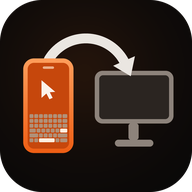

  

<h1 align="center">BlueDesk</h1>

  <b>Main app</b>: BlueDesk (Android)

  Transfer companion · helper apps for three platforms (Windows / Android / macOS)

  <a href="README.md">简体中文</a> | <b>English</b> | <a href="README.ja.md">日本語</a> | <a href="README.ko.md">한국어</a>

Companion apps for the "Transfer" page of the BlueDesk phone app. They talk to the phone over a
classic Bluetooth SPP data channel, turning **PC A → phone → PC B** text and small-file transfer
into a single click — the phone is the relay: any side can exchange data with it, or forward
to another PC.

> The data channel is independent of the HID (mouse/keyboard emulation) channel;
> one Bluetooth pairing serves both.

When the phone joins Wi-Fi, the PC automatically opens an additional **Wi-Fi (TCP) data channel**:
Bluetooth only handles discovery and control, file frames move to the LAN, and throughput rises
from 50–200 KB/s to tens of MB/s. If Wi-Fi is unavailable it silently falls back to Bluetooth,
with no change in usage.

This repository holds one implementation per platform. They share the same wire protocol,
so they **interoperate freely** — Windows sending to macOS, or Android to Windows, both work.

## Capability matrix

| Capability | Android | Windows | macOS |
|---|:---:|:---:|:---:|
| Send text | ✓ input box / paste / receive shares from other apps | ✓ clipboard | ✓ clipboard |
| Send a single file | ✓ | ✓ | ✓ |
| Send a whole folder | ✓ via SAF tree | ✓ `BATCH_*` frames | — |
| Receive text → clipboard | ✓ plus a notification | ✓ plus a balloon | ✓ plus a notification |
| Receive files | ✓ `Download/BlueDesk` | ✓ `Downloads\BlueDesk` | ✓ `~/Downloads/BlueDesk` |
| Receive a folder | ✓ | ✓ | ✓ `~/Downloads/BlueDesk` |
| Global hotkey | — | `Ctrl+Alt+B` / `Ctrl+Alt+F` | `Ctrl+Opt+B` / `Ctrl+Opt+F` |
| OS integration | share target | Explorer context menu | Finder Services |
| Runs in the background | foreground service + boot start | tray + `shell:startup` | menu bar + login items |
| Wi-Fi data channel (auto switch) | ✓ | ✓ | ✓ |
| Notification mirroring (phone → PC) | — | ✓ balloon | ✓ system notification |
| Two-way clipboard sync | — | ✓ automatic polling | ✓ automatic polling |
| Lock the PC when disconnected | — | ✓ policy from phone | ✓ policy from phone |
| Honors the phone's transfer limit | ✓ | ✓ | ✓ |

`—` means the feature isn't implemented on that platform yet; transfers between the other
two still work.

## At a glance

### Android

Kotlin + Jetpack Compose, with a foreground service keeping the connection alive; acts as a system
share target for text and files from other apps, and can also send whole folders.

- **Requirements**: JDK 17, Android SDK 36 (`minSdk 29` / `targetSdk 36`)
- **Build**: `cd BlueDeskRelayAndroid && ./gradlew assembleDebug`
  → output `app/build/outputs/apk/debug/app-debug.apk`
- **Source**: `BlueDeskRelayAndroid/app/src/main/java/com/lingzhi/bluedesk/relayandroid/`

### Windows

.NET 8 WinForms tray app with global hotkeys and an Explorer "Send to BlueDesk" context menu.

- **Requirements**: Windows 10 2004 (build 19041) or later, .NET 8 SDK
- **Build**: `cd BlueDeskRelayWindows && dotnet build -c Release`
  → output `bin\Release\net8.0-windows10.0.19041.0\BlueDeskRelay.exe`
- **Details**: [BlueDeskRelayWindows/README.md](BlueDeskRelayWindows/README.md)
  (including the NuGet `NU1301` build pitfall and the Connect Device menu)

### macOS

Swift + SwiftPM menu bar app (`LSUIElement`) built on IOBluetooth classic RFCOMM;
supports the Finder Services menu and global hotkeys.

- **Requirements**: macOS 12+, Xcode Command Line Tools
- **Build**: `cd BlueDeskRelayMac && ./bundle.sh`
  → output `BlueDesk Relay.app`
- **Details**: [BlueDeskRelayMac/README.md](BlueDeskRelayMac/README.md)

## Wire protocol

All three implementations are byte-for-byte aligned. The protocol lives in
`RelayProtocol.kt` (Android), `Protocol.cs` (Windows) and `Protocol.swift` (macOS).

- **Service UUID**: `a3bd7f2e-5c14-4a9e-9d1b-2f6e8c04bde1`
- **Frame format**: 11-byte header (MAGIC / version / type / FLAGS / length / CRC32 low 16 bits)
  plus payload
- **Frame types**: `HELLO`, `TEXT`, `FILE_META`, `FILE_CHUNK`, `FILE_END`, `ACK`, `PING`, `PONG`,
  `ERROR`, `CONFIG`, `BATCH_META`, `BATCH_END`, `NET_INFO`, `IDENT`,
  `AGENT_INFO`, `SCRIPT_STEP`, `SCRIPT_STEP_ACK`, `RECORD_CTRL`, `RECORD_RESULT`,
  `LIVE_INPUT`, `INPUT_STATE`, `NOTIFICATION`, `CLIPBOARD`, `DEVICE_POLICY`
- **Chunking**: Bluetooth 4 KB (limited by the RFCOMM MTU), Wi-Fi 64 KB
  (pushed in the `chunk` field of `NET_INFO`)
- **Transfer limit**: 64 MB by default, pushed from the phone via a `CONFIG` frame
  (0 means unlimited)
- **Throughput**: the SPP channel measures roughly 50–200 KB/s; the Wi-Fi channel is bound by the
  LAN and has been measured at tens of MB/s

### Wi-Fi data channel

Bluetooth remains the only discovery and control channel; Wi-Fi merely moves the data plane onto the LAN:

1. When transfer is enabled, the phone also listens on TCP (default port **47654**, shifted if taken).
2. Right after the PC connects over Bluetooth and sends `HELLO`, the phone sends `CONFIG` and then `NET_INFO`:
   `{"port":47654,"ips":["192.168.1.23"],"chunk":65536}`; an empty `ips` means the phone has no LAN address right now.
3. The PC records the endpoint and **silently drops Bluetooth**, reconnecting over TCP. The frame sequence
   afterwards is identical to Bluetooth — only the byte stream changes.
4. If TCP fails (different subnet, AP isolation, firewall, phone switched networks), it cools down for
   60 seconds and falls back to Bluetooth; after 3 consecutive failures it forgets the endpoint and waits
   for the phone to push a new one.

Over TCP the phone cannot see the peer's Bluetooth MAC, so the PC sends an `IDENT` right after `HELLO`:
`{"id":"<stable uuid>","bt":"AA:BB:CC:DD:EE:FF","platform":"win","transport":"tcp"}`.
The phone prefers `bt` as the session key, so forward groups and known-device lists still match.

The Wi-Fi endpoint is always pushed by the phone via `NET_INFO`; the PC offers no manual IP entry —
users only pair over Bluetooth, and channel setup and switching happen automatically.

> Older PC builds don't recognise `NET_INFO` and simply ignore it, staying on Bluetooth; the phone
> keeps using the MAC as the session key for sessions without `IDENT`. Both directions are backward
> compatible, so the two sides can be upgraded separately.

### Notifications / clipboard / live input / device policy

Besides text and files, the PC handles several frames pushed by the phone
(the Android app currently covers text and files only):

- **Notification mirroring**: the phone sends `NOTIFICATION {"app","title","text","at","pkg"}`;
  Windows shows a balloon, macOS posts a system notification.
- **Clipboard sync**: two-way `CLIPBOARD {"text","at"}`; the PC polls its own clipboard and sends
  changes automatically, while received text is written silently (no UI, both sides suppress loops).
- **Live input**: the phone sends `LIVE_INPUT` mouse/keyboard events; the PC injects them with
  `SendInput` / `CGEvent` and answers `INPUT_STATE {"appliedSeq","rtt","ok"}` (about once per 100 ms).
- **Device policy**: the phone sends `DEVICE_POLICY {"lockOnDisconnect":true}`; the PC caches the
  policy and locks the session when the control link drops.

### Script agent channel

A PC running the companion app can execute automation scripts on behalf of the phone,
so the phone no longer sends HID reports step by step:

1. After `HELLO` / `IDENT` the PC sends `AGENT_INFO`:
   `{"script":1,"platform":"win","unicode":1,"secure":0|1,"input":1,"text":1}`
   (`input` announces the live-input lane, `text` announces direct Unicode text).
2. The phone marks the device as "agent-capable" and prefers this channel; devices without it keep
   using the original HID path, and no script needs changing.
3. For every step the phone sends `SCRIPT_STEP`:
   `{"id":"uuid","t":"click","x":640,"y":360,"abs":true,"w":5,"k":"CTRL+A","txt":"…"}`.
4. The PC injects locally with `SendInput` (`CGEvent` on macOS) and replies `SCRIPT_STEP_ACK`:
   `{"id":"uuid","ok":true,"err":null}`.
5. If the ACK times out (3 s) or the link drops, the phone treats the step as failed and hands it to
   the existing retry / user-decision flow; it does **not** fall back to HID, so a step never runs twice.

Coordinates use the script's 1280×720 logical space and are scaled by the PC to the real screen;
text is injected as Unicode, so Chinese, emoji and IME output all work. macOS needs the Accessibility
permission; without it `AGENT_INFO.secure` is 0 and steps return an explicit error.

### Recording scripts on the PC

No menu hunting on the PC — everything starts from the phone:

1. Phone script page → "New script" → "Record on PC", then pick a PC running the companion app.
2. The phone sends `RECORD_CTRL {"on":true}`; the PC installs global input hooks and replies
   `RECORD_RESULT {"ok":true,"recording":true}`.
3. The user performs the actions normally; the PC only listens and never blocks
   (`WH_KEYBOARD_LL` / `WH_MOUSE_LL`, listen-only `CGEventTap` on macOS), skipping its own injected
   events by watermark.
4. The phone taps "Stop recording" → `RECORD_CTRL {"on":false}`; the PC replies
   `RECORD_RESULT {"ok":true,"name":"Recording …","script":{…}}` with the script inlined.
5. The phone imports it straight into the script library and reports success; the Windows app also
   keeps a copy at `Downloads/BlueDesk/record-*.json`, while macOS only returns it without saving.

The script format matches the phone exactly: `move / click / rclick / dclick / wheel / key / combo`,
with 1280×720 logical coordinates and `d` as the milliseconds since the previous step.

## Languages

All three platforms support **Simplified Chinese, English, Japanese and Korean**, switching with the
system language and falling back to English when nothing matches.

| Platform | Where the strings live |
|---|---|
| Android | `app/src/main/res/values*/strings.xml` (English by default plus `values-zh` / `-ja` / `-ko`) |
| Windows | `BlueDeskRelayWindows/Strings.cs` (four languages inline, chosen by `CultureInfo.CurrentUICulture`) |
| macOS | `Sources/BlueDeskRelayMac/Localization.swift` (UI strings) `Resources/<lang>.lproj/InfoPlist.strings` (system permission prompts, Finder service names) |

> Adding a language: drop one resource file per platform; `Get(zh, en, ja, ko)` in `Strings.cs`
> needs another parameter. Logs (`relay.log`, `NSLog`) are intentionally kept in Chinese so they line
> up with the code; they are not UI strings.

This README also ships in four languages; the switcher is at the top of each file.

## Usage (common to all platforms)

1. **Pair**: pair once with the phone (`BlueDesk-XXXXXX`) in the system Bluetooth settings.
   The same pairing provisions both the HID (mouse/keyboard) and SPP (data) channels.
2. **Phone**: open BlueDesk → "Transfer" tab at the bottom → enable transfer.
3. **PC**: start the app for your platform; it discovers the paired BlueDesk phone and connects.
   If the phone appears under its real model name (e.g. `S25U`, `SM-S9380`) instead of `BlueDesk*`,
   auto-discovery may miss it — pick it once via "Connect device" and it will be remembered.
   When the phone and PC share a Wi-Fi network, it switches to the Wi-Fi channel automatically
   (the menu shows `· Wi-Fi 192.168.x.x:47654`); if that fails it stays on Bluetooth.
4. **Transfer**: PC A sends → a record appears on the phone's "Transfer" page → tap "Forward…" and
   pick PC B → B writes it to the clipboard or disk and shows a notification.

## License

[Apache License 2.0](LICENSE)
