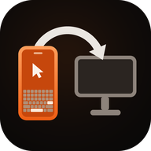

  

<h1 align="center">BlueDesk</h1>

  <b>メインアプリ</b>：BlueDesk（Android）

  転送アシスタント · 3 プラットフォーム向け補助アプリ（Windows / Android / macOS）

  <a href="README.md">简体中文</a> | <a href="README.en.md">English</a> | <b>日本語</b> | <a href="README.ko.md">한국어</a>

BlueDesk スマートフォンアプリの「転送」ページと組み合わせて使う 3 プラットフォーム向けの
補助アプリ集です。クラシック Bluetooth SPP データチャネルでスマートフォンと通信し、
**PC A → スマートフォン → PC B** のテキストと小容量ファイルの転送をワンクリックにします。
スマートフォンが中継役となり、どちらの端末からでもやり取りでき、別の PC へ転送することもできます。

> データチャネルは、スマートフォンがマウス／キーボードをエミュレートする HID チャネルとは独立しており、
> 同じ Bluetooth ペアリングで同時に利用できます。

スマートフォンが Wi-Fi に接続すると、PC は自動的に **Wi-Fi（TCP）データチャネル** を追加で開きます。
Bluetooth は検出と制御のみを担当し、ファイルのフレームは LAN に移り、スループットは
50〜200 KB/s から数十 MB/s に向上します。Wi-Fi が使えない場合は Bluetooth に静かに戻るため、
使い勝手は変わりません。

本リポジトリにはプラットフォームごとの実装が含まれており、同じ伝送プロトコルを共有しているため
**混在利用が可能** です。たとえば Windows から送信して macOS で受信する、Android と Windows の間で
やり取りする、といった使い方ができます。

## 3 プラットフォームの機能比較

| 機能 | Android | Windows | macOS |
|---|:---:|:---:|:---:|
| テキスト送信 | ✓ 入力欄 / 貼り付け / 他アプリの共有を受け取り | ✓ クリップボード | ✓ クリップボード |
| 単一ファイル送信 | ✓ | ✓ | ✓ |
| フォルダ送信 | ✓ SAF ディレクトリツリー経由 | ✓ `BATCH_*` 一括フレーム | — |
| テキスト受信 → クリップボード | ✓ 通知も表示 | ✓ バルーンも表示 | ✓ 通知も表示 |
| ファイル受信 | ✓ `Download/BlueDesk` | ✓ `Downloads\BlueDesk` | ✓ `~/Downloads/BlueDesk` |
| フォルダ受信 | ✓ | ✓ | ✓ `~/Downloads/BlueDesk` |
| グローバルホットキー | — | `Ctrl+Alt+B` / `Ctrl+Alt+F` | `Ctrl+Opt+B` / `Ctrl+Opt+F` |
| OS 連携 | システムの共有先 | エクスプローラの右クリックメニュー | Finder の「サービス」メニュー |
| バックグラウンド常駐 | フォアグラウンドサービス + 起動時自動開始 | トレイ + `shell:startup` | メニューバー + ログイン項目 |
| Wi-Fi データチャネル（自動切り替え） | ✓ | ✓ | ✓ |
| 通知ミラーリング（スマホ → PC） | — | ✓ バルーン | ✓ システム通知 |
| クリップボード双方向同期 | — | ✓ 自動ポーリング | ✓ 自動ポーリング |
| 切断時に自動ロック | — | ✓ スマホからのポリシー | ✓ スマホからのポリシー |
| スマホ側の転送上限に追従 | ✓ | ✓ | ✓ |

`—` はそのプラットフォームでは未実装という意味です。他の 2 端末間の転送には影響しません。

## 各プラットフォームの概要

### Android

Kotlin + Jetpack Compose。フォアグラウンドサービスで接続を維持し、他のアプリからのテキストや
ファイルをシステムの共有先として受け取れます。フォルダ送信にも対応しています。

- **要件**：JDK 17、Android SDK 36（`minSdk 29` / `targetSdk 36`）
- **ビルド**：`cd BlueDeskRelayAndroid && ./gradlew assembleDebug`
  → 生成物 `app/build/outputs/apk/debug/app-debug.apk`
- **ソース**：`BlueDeskRelayAndroid/app/src/main/java/com/lingzhi/bluedesk/relayandroid/`

### Windows

.NET 8 WinForms のトレイアプリで、グローバルホットキーとエクスプローラの右クリック
「BlueDesk に送信」に対応しています。

- **要件**：Windows 10 2004（build 19041）以降、.NET 8 SDK
- **ビルド**：`cd BlueDeskRelayWindows && dotnet build -c Release`
  → 生成物 `bin\Release\net8.0-windows10.0.19041.0\BlueDeskRelay.exe`
- **詳細**：[BlueDeskRelayWindows/README.md](BlueDeskRelayWindows/README.md)
  （NuGet `NU1301` のビルド注意点、デバイス接続メニューの説明を含む）

### macOS

Swift + SwiftPM のメニューバーアプリ（`LSUIElement`）。IOBluetooth のクラシック Bluetooth
RFCOMM を利用し、Finder の「サービス」メニューとグローバルホットキーに対応しています。

- **要件**：macOS 12 以降、Xcode Command Line Tools
- **ビルド**：`cd BlueDeskRelayMac && ./bundle.sh`
  → 生成物 `BlueDesk Relay.app`
- **詳細**：[BlueDeskRelayMac/README.md](BlueDeskRelayMac/README.md)

## 通信プロトコル

3 実装はバイト単位で一致しており、プロトコル定義はそれぞれ
`RelayProtocol.kt`（Android）、`Protocol.cs`（Windows）、`Protocol.swift`（macOS）にあります。

- **サービス UUID**：`a3bd7f2e-5c14-4a9e-9d1b-2f6e8c04bde1`
- **フレーム形式**：11 バイトのヘッダー（MAGIC / バージョン / 種別 / FLAGS / 長さ /
  CRC32 下位 16 ビット）+ ペイロード
- **フレーム種別**：`HELLO`、`TEXT`、`FILE_META`、`FILE_CHUNK`、`FILE_END`、`ACK`、`PING`、`PONG`、
  `ERROR`、`CONFIG`、`BATCH_META`、`BATCH_END`、`NET_INFO`、`IDENT`、
  `AGENT_INFO`、`SCRIPT_STEP`、`SCRIPT_STEP_ACK`、`RECORD_CTRL`、`RECORD_RESULT`、
  `LIVE_INPUT`、`INPUT_STATE`、`NOTIFICATION`、`CLIPBOARD`、`DEVICE_POLICY`
- **分割**：Bluetooth は 4 KB（RFCOMM の MTU による制限）、Wi-Fi は 64 KB
  （`NET_INFO` の `chunk` フィールドで通知）
- **転送上限**：既定 64 MB。スマートフォンから `CONFIG` フレームで一括指定されます（0 は無制限）
- **性能**：SPP チャネルは実測 50〜200 KB/s、Wi-Fi チャネルは LAN の性能に依存し、
  実測で数十 MB/s に達します

### Wi-Fi データチャネル

Bluetooth は引き続き検出と制御の唯一のチャネルであり、Wi-Fi は「データ面」を LAN に移すだけです。

1. スマートフォンで転送を有効にすると、同時に TCP を待ち受けます（既定ポート **47654**、使用中なら順にずれます）。
2. PC が Bluetooth で接続し `HELLO` を送ると、スマートフォンは続けて `CONFIG`、さらに `NET_INFO` を送ります：
   `{"port":47654,"ips":["192.168.1.23"],"chunk":65536}`。`ips` が空の場合はスマートフォンが
   現在 LAN のアドレスを持っていないことを意味します。
3. PC はエンドポイントを記録し、**Bluetooth を静かに切断**して TCP で再接続します。以降のフレーム列は
   Bluetooth とまったく同じで、バイトストリームが変わるだけです。
4. TCP に接続できない場合（別サブネット、AP アイソレーション、ファイアウォール、スマートフォンの
   ネットワーク変更など）は 60 秒間クールダウンして Bluetooth に戻ります。3 回連続で失敗すると
   エンドポイントを忘れ、スマートフォンからの再通知を待ちます。

TCP ではスマートフォンが相手の Bluetooth MAC を取得できないため、PC は `HELLO` の直後に `IDENT` を送ります：
`{"id":"<安定 uuid>","bt":"AA:BB:CC:DD:EE:FF","platform":"win","transport":"tcp"}`。
スマートフォンは `bt` をセッションキーとして優先するため、過去の転送グループや既知デバイス一覧が
ずれることはありません。

Wi-Fi のエンドポイントはすべてスマートフォンが `NET_INFO` で自動通知し、PC 側に IP を手入力する
入口はありません。ユーザーは Bluetooth のペアリングを済ませるだけで、チャネルの確立と切り替えは
すべて自動で行われます。

> 古い PC 版は `NET_INFO` を認識せず、そのまま無視して Bluetooth を継続します。スマートフォン側も
> `IDENT` のないセッションでは従来どおり MAC をキーにします。双方向とも後方互換のため、
> 段階的にアップグレードできます。

### 通知 / クリップボード / リアルタイム入力 / デバイスポリシー

テキストとファイル以外にも、PC はスマートフォンから送られるいくつかのフレームを処理します
（Android 版は現在テキストとファイルのみ対応）：

- **通知ミラーリング**：スマートフォンが `NOTIFICATION {"app","title","text","at","pkg"}` を送信。
  Windows はバルーン、macOS はシステム通知で表示します。
- **クリップボード同期**：双方向の `CLIPBOARD {"text","at"}`。PC は自身のクリップボードの変化を
  ポーリングして自動送信し、受信したテキストは静かにシステムクリップボードへ書き込みます
  （通知なし、両端でループを抑制）。
- **リアルタイム入力**：スマートフォンが `LIVE_INPUT` でキーボード／マウスイベントを送り、PC は
  `SendInput` / `CGEvent` で注入して `INPUT_STATE {"appliedSeq","rtt","ok"}` を返します（約 100 ms 間隔）。
- **デバイスポリシー**：スマートフォンが `DEVICE_POLICY {"lockOnDisconnect":true}` を送信。
  PC はポリシーをキャッシュし、制御リンクが切れたときにそれに従ってロックします。

### スクリプトエージェントチャネル

対応アプリを入れた PC は、スマートフォンの代わりに自動化スクリプトを実行できます。
スマートフォンは HID レポートを 1 ステップずつ送る必要がなくなります。

1. PC は `HELLO` / `IDENT` の後に `AGENT_INFO` を送ります：
   `{"script":1,"platform":"win","unicode":1,"secure":0|1,"input":1,"text":1}`
   （`input` はリアルタイム入力レーン、`text` は Unicode テキスト直接送信への対応を示します）。
2. スマートフォンはそのデバイスを「エージェント可」と記録し、このチャネルを優先します。
   受信していないデバイスは従来の HID チャネルのままで、スクリプト側の変更は不要です。
3. ステップごとにスマートフォンが `SCRIPT_STEP` を送ります：
   `{"id":"uuid","t":"click","x":640,"y":360,"abs":true,"w":5,"k":"CTRL+A","txt":"…"}`。
4. PC は `SendInput`（macOS は `CGEvent`）でローカルに注入し、`SCRIPT_STEP_ACK` を返します：
   `{"id":"uuid","ok":true,"err":null}`。
5. ACK のタイムアウト（3 秒）または切断で、スマートフォンはそのステップを失敗とみなし、
   既存のリトライ／ユーザー判断フローに渡します。**HID で再送しない**ため、同じステップが
   2 回実行されることはありません。

座標はスクリプトの 1280×720 論理座標を使い、PC が画面比率に合わせて変換します。テキストは
Unicode で注入されるため、中国語、emoji、任意の IME 入力もそのまま入力できます。macOS では
「アクセシビリティ」の許可が必要で、未許可の場合は `AGENT_INFO.secure` が 0 になり、
ステップは明確なエラーを返します。

### PC 上でスクリプトを記録する

PC 側でメニューを探す必要はなく、すべてスマートフォンから開始します。

1. スマートフォンのスクリプト画面 →「新規スクリプト」→「PC 上で記録」→ 対応アプリを入れた PC を選択。
2. スマートフォンが `RECORD_CTRL {"on":true}` を送信。PC はグローバルなキーボード／マウスフックを
   インストールし、`RECORD_RESULT {"ok":true,"recording":true}` を返します。
3. ユーザーが PC 上で普通に操作します。PC は監視のみで、入力はブロックしません
   （`WH_KEYBOARD_LL` / `WH_MOUSE_LL`、macOS は `CGEventTap` の listen-only）。
   自身が注入したイベントはウォーターマークで除外します。
4. スマートフォンで「記録終了」→ `RECORD_CTRL {"on":false}`。PC は
   `RECORD_RESULT {"ok":true,"name":"記録 …","script":{…}}` を返し、スクリプトをメッセージに
   インラインで含めます。
5. スマートフォンはそのままスクリプトライブラリへ取り込み、完了を表示します。Windows 版は
   同時に `ダウンロード/BlueDesk/record-*.json` にバックアップを残しますが、macOS 版は
   返送のみで保存しません。

スクリプト形式はスマートフォンと完全に同一です：`move / click / rclick / dclick / wheel / key / combo`、
座標は 1280×720 の論理座標、`d` は前のステップからの経過ミリ秒です。

## 多言語対応

3 プラットフォームとも **簡体字中国語、English、日本語、한국어** に対応し、システム言語で自動的に
切り替わります。一致する言語がない場合は英語にフォールバックします。

| プラットフォーム | 文言の場所 |
|---|---|
| Android | `app/src/main/res/values*/strings.xml`（既定は英語 + `values-zh` / `-ja` / `-ko`） |
| Windows | `BlueDeskRelayWindows/Strings.cs`（4 言語を内蔵、`CultureInfo.CurrentUICulture` で判定） |
| macOS | `Sources/BlueDeskRelayMac/Localization.swift`（UI 文言） `Resources/<lang>.lproj/InfoPlist.strings`（システム権限のダイアログ、Finder サービス名） |

> 言語の追加：各プラットフォームに対応するリソースを 1 つ追加するだけです。`Strings.cs` の
> `Get(zh, en, ja, ko)` は引数を増やす必要があります。ログ（`relay.log`、`NSLog`）はコードと
> 照合しやすいよう意図的に中国語のままで、UI 文言には含まれません。

この README 自体も 4 言語で提供しており、切り替えリンクは各ファイルの先頭にあります。

## 使い方（共通）

1. **ペアリング**：システムの Bluetooth 設定でスマートフォン（`BlueDesk-XXXXXX`）と一度ペアリングします。
   このペアリングで HID（キーボード／マウス）と SPP（データ）の両チャネルの資格情報が確立されます。
2. **スマートフォン側**：BlueDesk を開く → 下部の「転送」タブ → 転送を有効化。
3. **PC 側**：該当プラットフォームのアプリを起動すると、ペアリング済みの BlueDesk スマートフォンを
   自動検出して接続します。スマートフォンがシステム上で実機名（`S25U`、`SM-S9380` など）として
   表示され `BlueDesk*` になっていない場合、自動検出できないことがあります。その場合は
   「デバイスに接続」で一度選べば、以後は記憶されます。
   スマートフォンと PC が同じ Wi-Fi にいる場合、接続後に自動で Wi-Fi チャネルへ切り替わります
   （メニューに `· Wi-Fi 192.168.x.x:47654` と表示）。切り替えできない場合は Bluetooth のままで、
   利用に影響はありません。
4. **転送**：PC A から送信 → スマートフォンの「転送」ページに履歴が表示 → 「転送…」で PC B を選択
   → B 側が自動でクリップボードへ書き込むかファイルを保存し、通知を表示します。

## ライセンス

[Apache License 2.0](LICENSE)
