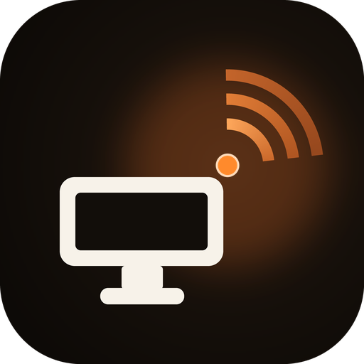

  

<h1 align="center">BlueDesk</h1>

  <b>릴레이</b> · 3개 플랫폼용 보조 앱 (Windows / Android / macOS)

  <a href="README.md">简体中文</a> | <a href="README.en.md">English</a> | <a href="README.ja.md">日本語</a> | <b>한국어</b>

BlueDesk 스마트폰 앱의 '릴레이' 페이지와 함께 사용하는 3개 플랫폼용 보조 앱 모음입니다.
클래식 블루투스 SPP 데이터 채널로 스마트폰과 통신하여
**PC A → 스마트폰 → PC B** 텍스트/소용량 파일 전송을 클릭 한 번으로 처리합니다.
스마트폰이 중계 역할을 하므로 어느 단말이든 스마트폰과 주고받을 수 있고,
다른 PC로 다시 전달할 수도 있습니다.

> 데이터 채널은 키보드·마우스용 HID 채널과 독립적이므로,
> 한 번의 블루투스 페어링으로 두 채널을 동시에 사용할 수 있습니다.

이 저장소에는 플랫폼별 구현이 각각 들어 있습니다. 프로토콜이 동일하므로
**서로 자유롭게 섞어 쓸 수 있습니다** — Windows에서 macOS로, Android에서 Windows로 모두 가능합니다.

## 플랫폼별 기능 비교

| 기능 | Android | Windows | macOS |
|---|:---:|:---:|:---:|
| 텍스트 전송 | ✓ 입력창 / 붙여넣기 / 다른 앱의 공유 받기 | ✓ 클립보드 | ✓ 클립보드 |
| 단일 파일 전송 | ✓ | ✓ | ✓ |
| 폴더 전체 전송 | ✓ SAF 디렉터리 트리 사용 | ✓ `BATCH_*` 프레임 | — |
| 텍스트 수신 → 클립보드 | ✓ 알림도 표시 | ✓ 풍선 알림도 표시 | ✓ 알림도 표시 |
| 파일 수신 | ✓ `Download/BlueDesk` | ✓ `Downloads\BlueDesk` | ✓ `~/Downloads/BlueDesk` |
| 폴더 수신 | ✓ | ✓ | — |
| 전역 단축키 | — | `Ctrl+Alt+B` / `Ctrl+Alt+F` | `Ctrl+Opt+B` / `Ctrl+Opt+F` |
| OS 통합 | 시스템 공유 대상 | 탐색기 우클릭 메뉴 | Finder '서비스' 메뉴 |
| 백그라운드 상주 | 포그라운드 서비스 + 부팅 시 자동 시작 | 트레이 + `shell:startup` | 메뉴 막대 + 로그인 항목 |
| 폰이 지정한 전송 한도 준수 | ✓ | ✓ | — 64 MB 고정 |

`—` 는 해당 플랫폼에서 아직 구현되지 않았다는 뜻이며, 나머지 두 단말 간 전송에는 영향이 없습니다.

## 플랫폼별 개요

### Android

Kotlin + Jetpack Compose. 포그라운드 서비스로 연결을 유지합니다.
다른 앱의 텍스트와 파일을 시스템 공유 대상으로 받을 수 있고, 폴더 전송도 지원합니다.

- **요구 사항**: JDK 17, Android SDK 36 (`minSdk 29` / `targetSdk 36`)
- **빌드**: `cd BlueDeskRelayAndroid && ./gradlew assembleDebug`
  → 결과물 `app/build/outputs/apk/debug/app-debug.apk`
- **소스**: `BlueDeskRelayAndroid/app/src/main/java/com/lingzhi/bluedesk/relayandroid/`

### Windows

.NET 8 WinForms 트레이 앱. 전역 단축키와 탐색기 우클릭 'BlueDesk로 전송'을 지원합니다.

- **요구 사항**: Windows 10 2004(build 19041) 이상, .NET 8 SDK
- **빌드**: `cd BlueDeskRelayWindows && dotnet build -c Release`
  → 결과물 `bin\Release\net8.0-windows10.0.19041.0\BlueDeskRelay.exe`
- **자세히**: [BlueDeskRelayWindows/README.md](BlueDeskRelayWindows/README.md)
  (NuGet `NU1301` 빌드 문제와 기기 연결 메뉴 설명 포함)

### macOS

Swift + SwiftPM 메뉴 막대 앱(`LSUIElement`). IOBluetooth 클래식 RFCOMM 기반이며
Finder '서비스' 메뉴와 전역 단축키를 지원합니다.

- **요구 사항**: macOS 12 이상, Xcode Command Line Tools
- **빌드**: `cd BlueDeskRelayMac && ./bundle.sh`
  → 결과물 `BlueDesk Relay.app`
- **자세히**: [BlueDeskRelayMac/README.md](BlueDeskRelayMac/README.md)

## 통신 프로토콜

세 구현은 바이트 단위로 일치합니다. 프로토콜 정의는 각각
`RelayProtocol.kt`(Android), `Protocol.cs`(Windows), `Protocol.swift`(macOS)에 있습니다.

- **서비스 UUID**: `a3bd7f2e-5c14-4a9e-9d1b-2f6e8c04bde1`
- **프레임 형식**: 11바이트 헤더(MAGIC / 버전 / 타입 / FLAGS / 길이 / CRC32 하위 16비트) + 페이로드
- **프레임 타입**: `HELLO`, `TEXT`, `FILE_META`, `FILE_CHUNK`, `FILE_END`, `ACK`, `PING`, `PONG`,
  `ERROR`, `CONFIG`, `BATCH_META`, `BATCH_END`
- **분할**: 파일은 4 KB 단위로 나누어 전송
- **전송 한도**: 기본 64 MB이며, 폰이 `CONFIG` 프레임으로 일괄 지정합니다(0은 무제한)
- **성능**: SPP 채널은 실측 50~200 KB/s 정도로, 텍스트와 몇 MB 이내 파일에 적합합니다

## 다국어 지원

세 플랫폼 모두 **简体中文 · English · 日本語 · 한국어** 를 지원합니다.
시스템 언어 설정을 자동으로 따르며, 그 외 언어는 영어로 대체됩니다.

| 플랫폼 | 문구 위치 |
|---|---|
| Android | `app/src/main/res/values*/strings.xml` (영어 기본 + `values-zh` / `-ja` / `-ko`) |
| Windows | `BlueDeskRelayWindows/Strings.cs` (4개 언어 내장, `CultureInfo.CurrentUICulture` 로 판별) |
| macOS | `Sources/BlueDeskRelayMac/Localization.swift` (UI 문구) `Resources/<lang>.lproj/InfoPlist.strings` (시스템 권한 안내, Finder 서비스 이름) |

> 언어 추가: 플랫폼마다 해당 리소스 파일을 추가하면 됩니다.
> `Strings.cs` 의 `Get(zh, en, ja, ko)` 는 인자를 하나 더 늘려야 합니다.
> 로그(`relay.log`, `NSLog`)는 소스와 대조해 확인하기 위해 의도적으로 중국어로 두었으며,
> UI 문구에 포함되지 않습니다.

이 README 자체도 4개 언어로 제공됩니다. 각 파일 상단의 전환 링크를 이용하세요.

## 사용 방법(공통)

1. **페어링**: 시스템 블루투스 설정에서 스마트폰(`BlueDesk-XXXXXX`)과 한 번 페어링합니다.
   페어링 시 HID(키보드·마우스)와 SPP(데이터) 두 채널의 자격 증명이 만들어집니다.
2. **스마트폰**: BlueDesk 실행 → 하단 '릴레이' 탭 → 릴레이 켜기.
3. **PC**: 해당 플랫폼의 앱을 실행합니다. 페어링된 BlueDesk 스마트폰을 자동으로 찾아 연결합니다.
   스마트폰이 `BlueDesk*` 대신 실제 모델명(`S25U`, `SM-S9380` 등)으로 표시되면 자동 검색에서
   찾지 못할 수 있습니다. '기기 연결'에서 한 번 직접 선택하면 이후 기억됩니다.
4. **전송**: PC A가 전송 → 스마트폰 '릴레이' 페이지에 기록이 나타남 → '전달…'을 눌러 PC B 선택
   → B가 자동으로 클립보드에 기록하거나 파일을 저장하고 알림을 표시합니다.

## 라이선스

[Apache License 2.0](LICENSE)
