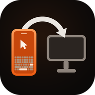

  

<h1 align="center">BlueDesk</h1>

  <b>메인 앱</b>: BlueDesk (Android)

  전송 도우미 · 3개 플랫폼 보조 앱 (Windows / Android / macOS)

  <a href="README.md">简体中文</a> | <a href="README.en.md">English</a> | <a href="README.ja.md">日本語</a> | <b>한국어</b>

BlueDesk 스마트폰 앱의 '전송' 페이지와 함께 사용하는 3개 플랫폼 보조 앱 모음입니다.
클래식 블루투스 SPP 데이터 채널로 스마트폰과 통신하며, **PC A → 스마트폰 → PC B** 의 텍스트와
소용량 파일 전송을 클릭 한 번으로 만듭니다. 스마트폰이 중계 역할을 하므로 어느 쪽에서든 주고받을 수
있고, 다른 PC로 전달할 수도 있습니다.

> 데이터 채널은 스마트폰이 마우스/키보드를 에뮬레이션하는 HID 채널과 독립적이며,
> 같은 블루투스 페어링으로 동시에 사용할 수 있습니다.

스마트폰이 Wi-Fi에 연결되면 PC는 자동으로 **Wi-Fi(TCP) 데이터 채널** 을 하나 더 엽니다.
블루투스는 검색과 제어만 담당하고 파일 프레임은 LAN으로 옮겨져 처리량이 50~200 KB/s에서
수십 MB/s로 올라갑니다. Wi-Fi를 쓸 수 없으면 조용히 블루투스로 되돌아가므로 사용 방식은 그대로입니다.

이 저장소에는 플랫폼별 구현이 각각 들어 있으며, 동일한 전송 프로토콜을 공유하므로 **혼용이 가능** 합니다.
예를 들어 Windows에서 보내고 macOS에서 받거나, Android와 Windows 사이에서 주고받을 수 있습니다.

## 플랫폼별 기능 비교

| 기능 | Android | Windows | macOS |
|---|:---:|:---:|:---:|
| 텍스트 전송 | ✓ 입력창 / 붙여넣기 / 다른 앱의 공유 받기 | ✓ 클립보드 | ✓ 클립보드 |
| 단일 파일 전송 | ✓ | ✓ | ✓ |
| 폴더 전체 전송 | ✓ SAF 디렉터리 트리 사용 | ✓ `BATCH_*` 일괄 프레임 | — |
| 텍스트 수신 → 클립보드 | ✓ 알림도 표시 | ✓ 풍선 알림도 표시 | ✓ 알림도 표시 |
| 파일 수신 | ✓ `Download/BlueDesk` | ✓ `Downloads\BlueDesk` | ✓ `~/Downloads/BlueDesk` |
| 폴더 수신 | ✓ | ✓ | ✓ `~/Downloads/BlueDesk` |
| 전역 단축키 | — | `Ctrl+Alt+B` / `Ctrl+Alt+F` | `Ctrl+Opt+B` / `Ctrl+Opt+F` |
| OS 통합 | 시스템 공유 대상 | 탐색기 우클릭 메뉴 | Finder '서비스' 메뉴 |
| 백그라운드 상주 | 포그라운드 서비스 + 부팅 시 자동 시작 | 트레이 + `shell:startup` | 메뉴 막대 + 로그인 항목 |
| Wi-Fi 데이터 채널(자동 전환) | ✓ | ✓ | ✓ |
| 알림 미러링(스마트폰 → PC) | — | ✓ 풍선 알림 | ✓ 시스템 알림 |
| 클립보드 양방향 동기화 | — | ✓ 자동 폴링 | ✓ 자동 폴링 |
| 연결 해제 시 자동 잠금 | — | ✓ 스마트폰이 내려준 정책 | ✓ 스마트폰이 내려준 정책 |
| 스마트폰의 전송 한도 준수 | ✓ | ✓ | ✓ |

`—` 는 해당 플랫폼에서 아직 구현되지 않았다는 뜻이며, 나머지 두 단말 간 전송에는 영향이 없습니다.

## 플랫폼별 개요

### Android

Kotlin + Jetpack Compose. 포그라운드 서비스로 연결을 유지하며, 다른 앱의 텍스트와 파일을
시스템 공유 대상으로 받을 수 있고 폴더 전송도 지원합니다.

- **요구 사항**: JDK 17, Android SDK 36 (`minSdk 29` / `targetSdk 36`)
- **빌드**: `cd BlueDeskRelayAndroid && ./gradlew assembleDebug`
  → 산출물 `app/build/outputs/apk/debug/app-debug.apk`
- **소스**: `BlueDeskRelayAndroid/app/src/main/java/com/lingzhi/bluedesk/relayandroid/`

### Windows

.NET 8 WinForms 트레이 앱으로, 전역 단축키와 탐색기 우클릭 'BlueDesk로 보내기'를 지원합니다.

- **요구 사항**: Windows 10 2004(build 19041) 이상, .NET 8 SDK
- **빌드**: `cd BlueDeskRelayWindows && dotnet build -c Release`
  → 산출물 `bin\Release\net8.0-windows10.0.19041.0\BlueDeskRelay.exe`
- **자세히**: [BlueDeskRelayWindows/README.md](BlueDeskRelayWindows/README.md)
  (NuGet `NU1301` 빌드 이슈, 장치 연결 메뉴 설명 포함)

### macOS

Swift + SwiftPM 메뉴 막대 앱(`LSUIElement`)으로, IOBluetooth의 클래식 블루투스 RFCOMM을 사용합니다.
Finder '서비스' 메뉴와 전역 단축키를 지원합니다.

- **요구 사항**: macOS 12 이상, Xcode Command Line Tools
- **빌드**: `cd BlueDeskRelayMac && ./bundle.sh`
  → 산출물 `BlueDesk Relay.app`
- **자세히**: [BlueDeskRelayMac/README.md](BlueDeskRelayMac/README.md)

## 통신 프로토콜

세 구현은 바이트 단위로 일치하며, 프로토콜 정의는 각각
`RelayProtocol.kt`(Android), `Protocol.cs`(Windows), `Protocol.swift`(macOS)에 있습니다.

- **서비스 UUID**: `a3bd7f2e-5c14-4a9e-9d1b-2f6e8c04bde1`
- **프레임 형식**: 11바이트 헤더(MAGIC / 버전 / 종류 / FLAGS / 길이 / CRC32 하위 16비트) + 페이로드
- **프레임 종류**: `HELLO`, `TEXT`, `FILE_META`, `FILE_CHUNK`, `FILE_END`, `ACK`, `PING`, `PONG`,
  `ERROR`, `CONFIG`, `BATCH_META`, `BATCH_END`, `NET_INFO`, `IDENT`,
  `AGENT_INFO`, `SCRIPT_STEP`, `SCRIPT_STEP_ACK`, `RECORD_CTRL`, `RECORD_RESULT`,
  `LIVE_INPUT`, `INPUT_STATE`, `NOTIFICATION`, `CLIPBOARD`, `DEVICE_POLICY`
- **분할**: 블루투스 4 KB(RFCOMM MTU 제약), Wi-Fi 64 KB(`NET_INFO`의 `chunk` 필드로 전달)
- **전송 한도**: 기본 64 MB이며, 스마트폰이 `CONFIG` 프레임으로 일괄 지정합니다(0은 무제한)
- **성능**: SPP 채널은 실측 약 50~200 KB/s, Wi-Fi 채널은 LAN 성능에 따라 수십 MB/s까지 나옵니다

### Wi-Fi 데이터 채널

블루투스는 여전히 유일한 검색·제어 채널이고, Wi-Fi는 '데이터 영역'만 LAN으로 옮깁니다.

1. 스마트폰에서 전송을 켜면 동시에 TCP를 수신 대기합니다(기본 포트 **47654**, 사용 중이면 순차적으로 변경).
2. PC가 블루투스로 연결해 `HELLO`를 보내면, 스마트폰은 이어서 `CONFIG`와 `NET_INFO`를 보냅니다:
   `{"port":47654,"ips":["192.168.1.23"],"chunk":65536}`. `ips`가 비어 있으면 스마트폰이 현재
   LAN 주소를 가지고 있지 않다는 뜻입니다.
3. PC는 엔드포인트를 기록하고 **블루투스를 조용히 끊은 뒤** TCP로 다시 연결합니다. 이후 프레임 순서는
   블루투스와 완전히 같고 바이트 스트림만 바뀝니다.
4. TCP 연결이 안 되면(다른 서브넷, AP 격리, 방화벽, 스마트폰 네트워크 변경 등) 60초 동안 대기한 뒤
   블루투스로 되돌아갑니다. 3회 연속 실패하면 엔드포인트를 잊고 스마트폰의 재전송을 기다립니다.

TCP에서는 스마트폰이 상대의 블루투스 MAC을 알 수 없으므로, PC는 `HELLO` 직후 `IDENT`를 보냅니다:
`{"id":"<안정 uuid>","bt":"AA:BB:CC:DD:EE:FF","platform":"win","transport":"tcp"}`.
스마트폰은 `bt`를 세션 키로 우선 사용하므로 기존 전달 그룹과 알려진 장치 목록이 어긋나지 않습니다.

Wi-Fi 엔드포인트는 모두 스마트폰이 `NET_INFO`로 자동 전달하며, PC에는 IP를 직접 입력하는 입구가 없습니다.
사용자는 블루투스 페어링만 하면 되고 채널 생성과 전환은 모두 자동으로 이루어집니다.

> 구버전 PC는 `NET_INFO`를 인식하지 못해 그냥 무시하고 블루투스를 계속 사용합니다. 스마트폰도
> `IDENT`가 없는 세션에서는 기존처럼 MAC을 키로 사용합니다. 양방향 모두 하위 호환이므로
> 양쪽을 나누어 업그레이드할 수 있습니다.

### 알림 / 클립보드 / 실시간 입력 / 장치 정책

텍스트와 파일 외에도 PC는 스마트폰이 보내는 몇 가지 프레임을 처리합니다
(Android 앱은 현재 텍스트와 파일만 지원):

- **알림 미러링**: 스마트폰이 `NOTIFICATION {"app","title","text","at","pkg"}`를 보내면
  Windows는 풍선 알림, macOS는 시스템 알림으로 표시합니다.
- **클립보드 동기화**: 양방향 `CLIPBOARD {"text","at"}`. PC는 자체 클립보드 변화를 폴링해 자동으로
  보내고, 받은 텍스트는 조용히 시스템 클립보드에 기록합니다(알림 없음, 양쪽에서 루프 억제).
- **실시간 입력**: 스마트폰이 `LIVE_INPUT`으로 키보드/마우스 이벤트를 보내면, PC는
  `SendInput` / `CGEvent`로 주입하고 `INPUT_STATE {"appliedSeq","rtt","ok"}`를 돌려줍니다(약 100 ms 간격).
- **장치 정책**: 스마트폰이 `DEVICE_POLICY {"lockOnDisconnect":true}`를 보내면 PC는 정책을 캐시하고,
  제어 링크가 끊길 때 그에 따라 화면을 잠급니다.

### 스크립트 에이전트 채널

보조 앱이 설치된 PC는 스마트폰 대신 자동화 스크립트를 실행할 수 있어, 스마트폰이 HID 리포트를
한 단계씩 보낼 필요가 없습니다.

1. PC는 `HELLO` / `IDENT` 이후 `AGENT_INFO`를 보냅니다:
   `{"script":1,"platform":"win","unicode":1,"secure":0|1,"input":1,"text":1}`
   (`input`은 실시간 입력 레인 지원, `text`는 Unicode 텍스트 직접 전송 지원을 뜻합니다).
2. 스마트폰은 해당 장치를 '에이전트 가능'으로 표시하고 이 채널을 우선 사용합니다. 받지 못한 장치는
   기존 HID 채널을 그대로 쓰며, 스크립트 자체는 수정할 필요가 없습니다.
3. 단계마다 스마트폰이 `SCRIPT_STEP`을 보냅니다:
   `{"id":"uuid","t":"click","x":640,"y":360,"abs":true,"w":5,"k":"CTRL+A","txt":"…"}`.
4. PC는 `SendInput`(macOS는 `CGEvent`)으로 로컬 주입하고 `SCRIPT_STEP_ACK`를 돌려줍니다:
   `{"id":"uuid","ok":true,"err":null}`.
5. ACK가 시간 초과(3초)되거나 연결이 끊기면 스마트폰은 해당 단계를 실패로 보고 기존 재시도/사용자
   판단 흐름으로 넘깁니다. **HID로 다시 보내지 않으므로** 같은 단계가 두 번 실행되지 않습니다.

좌표는 스크립트의 1280×720 논리 좌표를 사용하며 PC가 화면 비율에 맞춰 변환합니다. 텍스트는
Unicode로 주입되어 중국어, emoji, 임의의 입력기 내용도 그대로 입력됩니다. macOS는 '손쉬운 사용'
권한이 필요하며, 없으면 `AGENT_INFO.secure`가 0이 되고 단계는 명확한 오류를 반환합니다.

### PC에서 스크립트 기록하기

PC에서 메뉴를 찾을 필요 없이 모든 것은 스마트폰에서 시작합니다.

1. 스마트폰 스크립트 페이지 → '새 스크립트' → 'PC에서 기록' → 보조 앱이 설치된 PC 선택.
2. 스마트폰이 `RECORD_CTRL {"on":true}`를 보내면, PC는 전역 키보드/마우스 훅을 설치하고
   `RECORD_RESULT {"ok":true,"recording":true}`를 돌려줍니다.
3. 사용자가 PC에서 평소처럼 조작합니다. PC는 수신만 하고 입력을 막지 않으며
   (`WH_KEYBOARD_LL` / `WH_MOUSE_LL`, macOS는 listen-only `CGEventTap`), 자기가 주입한 이벤트는
   워터마크로 걸러냅니다.
4. 스마트폰에서 '기록 종료' → `RECORD_CTRL {"on":false}`. PC는
   `RECORD_RESULT {"ok":true,"name":"기록 …","script":{…}}`를 반환하며 스크립트를 메시지에 함께 담습니다.
5. 스마트폰은 그대로 스크립트 라이브러리에 저장하고 완료를 알립니다. Windows는 동시에
   `다운로드/BlueDesk/record-*.json`에 백업을 남기지만, macOS는 전달만 하고 저장하지 않습니다.

스크립트 형식은 스마트폰과 완전히 같습니다: `move / click / rclick / dclick / wheel / key / combo`,
좌표는 1280×720 논리 좌표, `d`는 이전 단계로부터의 밀리초 간격입니다.

## 다국어 지원

세 플랫폼 모두 **중국어 간체, English, 日本語, 한국어** 를 지원하며 시스템 언어에 따라 자동으로
전환되고, 일치하는 언어가 없으면 영어로 대체됩니다.

| 플랫폼 | 문구 위치 |
|---|---|
| Android | `app/src/main/res/values*/strings.xml` (기본 영어 + `values-zh` / `-ja` / `-ko`) |
| Windows | `BlueDeskRelayWindows/Strings.cs` (4개 언어 내장, `CultureInfo.CurrentUICulture`로 판정) |
| macOS | `Sources/BlueDeskRelayMac/Localization.swift` (UI 문구) `Resources/<lang>.lproj/InfoPlist.strings` (시스템 권한 대화상자, Finder 서비스 이름) |

> 언어 추가: 플랫폼마다 해당 리소스를 하나씩 추가하면 됩니다. `Strings.cs`의 `Get(zh, en, ja, ko)`는
> 인자를 늘려야 합니다. 로그(`relay.log`, `NSLog`)는 코드와 대조하기 쉽도록 의도적으로 중국어로
> 유지하며 UI 문구에 포함되지 않습니다.

이 README 자체도 4개 언어로 제공되며, 전환 링크는 각 파일 상단에 있습니다.

## 사용 방법(공통)

1. **페어링**: 시스템 블루투스 설정에서 스마트폰(`BlueDesk-XXXXXX`)과 한 번 페어링합니다.
   이 페어링으로 HID(키보드/마우스)와 SPP(데이터) 두 채널의 자격 증명이 함께 만들어집니다.
2. **스마트폰**: BlueDesk 실행 → 하단 '전송' 탭 → 전송 켜기.
3. **PC**: 해당 플랫폼 앱을 실행하면 페어링된 BlueDesk 스마트폰을 자동으로 찾아 연결합니다.
   스마트폰이 시스템에 실제 모델명(`S25U`, `SM-S9380` 등)으로 표시되어 `BlueDesk*`가 아니라면
   자동 검색이 찾지 못할 수 있습니다. 이때 '장치 연결'에서 한 번 선택하면 이후 기억합니다.
   스마트폰과 PC가 같은 Wi-Fi에 있으면 연결 후 자동으로 Wi-Fi 채널로 전환됩니다
   (메뉴에 `· Wi-Fi 192.168.x.x:47654` 표시). 전환되지 않으면 블루투스를 계속 사용하며 사용에는 영향이 없습니다.
4. **전송**: PC A에서 보내면 스마트폰 '전송' 페이지에 기록이 나타나고 → '전달…'에서 PC B를 선택하면
   → B가 자동으로 클립보드에 쓰거나 파일로 저장하고 알림을 표시합니다.

## 라이선스

[Apache License 2.0](LICENSE)
