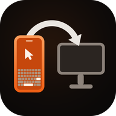

  

<h1 align="center">BlueDesk</h1>

  <b>主应用</b>：BlueDesk（Android）

  互传助手 · 三端辅助程序（Windows / Android / macOS）

  <b>简体中文</b> | <a href="README.en.md">English</a> | <a href="README.ja.md">日本語</a> | <a href="README.ko.md">한국어</a>

配合 BlueDesk 手机端「互传」页使用的三端辅助程序集合。
通过经典蓝牙 SPP 数据通道与手机通信，让 **A 电脑 → 手机 → B 电脑** 的文本与小文件互传
变成一次点击 —— 手机作为中转站，任一端都可以和手机互传，也可以借手机转发给另一台电脑。

> 数据通道与手机模拟键鼠的 HID 通道互相独立，同一套蓝牙配对即可同时使用。

手机连上 Wi-Fi 时，PC 会自动再开一条 **Wi-Fi（TCP）数据通道**：蓝牙只负责发现与控制，
文件帧改走局域网，吞吐从 50~200 KB/s 提升到几十 MB/s。Wi-Fi 不可用时静默回落蓝牙，
使用体验不变。

本仓库包含三个平台各自的实现，它们共用同一套传输协议，因此 **可以混用**：
例如 Windows 发、macOS 收，或 Android 与 Windows 之间互传。

## 三端能力对照

| 能力 | Android | Windows | macOS |
|---|:---:|:---:|:---:|
| 发送文本 | ✓ 输入框 / 粘贴 / 接收其他 App 分享 | ✓ 剪贴板 | ✓ 剪贴板 |
| 发送单个文件 | ✓ | ✓ | ✓ |
| 发送整个文件夹 | ✓ 经 SAF 目录树 | ✓ `BATCH_*` 批量帧 | — |
| 接收文本 → 剪贴板 | ✓ 同时发通知 | ✓ 同时弹气泡 | ✓ 同时发通知 |
| 接收文件 | ✓ `Download/BlueDesk` | ✓ `Downloads\BlueDesk` | ✓ `~/Downloads/BlueDesk` |
| 接收文件夹 | ✓ | ✓ | — |
| 全局热键 | — | `Ctrl+Alt+B` / `Ctrl+Alt+F` | `Ctrl+Opt+B` / `Ctrl+Opt+F` |
| 系统集成 | 系统分享目标 | 资源管理器右键菜单 | Finder「服务」菜单 |
| 后台常驻 | 前台服务 + 开机自启 | 托盘 + `shell:startup` | 菜单栏 + 登录项 |
| Wi-Fi 数据通道（自动切换） | ✓ | ✓ | ✓ |
| 遵循手机下发的传输上限 | ✓ | ✓ | ✓ |

`—` 表示该端暂未实现，不影响其他两端之间的互传。

## 各端速览

### Android

Kotlin + Jetpack Compose，前台服务常驻保持连接；可作为系统分享目标接收其他 App 的文字与文件，
也支持发送整个文件夹。

- **要求**：JDK 17、Android SDK 36（`minSdk 29` / `targetSdk 36`）
- **构建**：`cd BlueDeskRelayAndroid && ./gradlew assembleDebug`
  → 产物 `app/build/outputs/apk/debug/app-debug.apk`
- **源码**：`BlueDeskRelayAndroid/app/src/main/java/com/lingzhi/bluedesk/relayandroid/`

### Windows

.NET 8 WinForms 托盘程序，支持全局热键与资源管理器右键「发送到 BlueDesk」。

- **要求**：Windows 10 2004（build 19041）及以上、.NET 8 SDK
- **构建**：`cd BlueDeskRelayWindows && dotnet build -c Release`
  → 产物 `bin\Release\net8.0-windows10.0.19041.0\BlueDeskRelay.exe`
- **详见**：[BlueDeskRelayWindows/README.md](BlueDeskRelayWindows/README.md)
  （含 NuGet `NU1301` 构建踩坑、连接设备菜单说明）

### macOS

Swift + SwiftPM 菜单栏程序（`LSUIElement`），基于 IOBluetooth 的经典蓝牙 RFCOMM；
支持 Finder「服务」菜单与全局热键。

- **要求**：macOS 12+、Xcode Command Line Tools
- **构建**：`cd BlueDeskRelayMac && ./bundle.sh`
  → 产物 `BlueDesk Relay.app`
- **详见**：[BlueDeskRelayMac/README.md](BlueDeskRelayMac/README.md)

## 通信协议

三端实现逐字节对齐，协议定义分别位于
`RelayProtocol.kt`（Android）、`Protocol.cs`（Windows）、`Protocol.swift`（macOS）。

- **服务 UUID**：`a3bd7f2e-5c14-4a9e-9d1b-2f6e8c04bde1`
- **帧格式**：11 字节头（MAGIC / 版本 / 类型 / FLAGS / 长度 / CRC32 低 16 位）+ 载荷
- **帧类型**：`HELLO`、`TEXT`、`FILE_META`、`FILE_CHUNK`、`FILE_END`、`ACK`、`PING`、`PONG`、
  `ERROR`、`CONFIG`、`BATCH_META`、`BATCH_END`、`NET_INFO`、`IDENT`、
  `AGENT_INFO`、`SCRIPT_STEP`、`SCRIPT_STEP_ACK`、`RECORD_CTRL`、`RECORD_RESULT`
- **分块**：蓝牙 4 KB（受 RFCOMM MTU 限制），Wi-Fi 64 KB（由 `NET_INFO` 的 `chunk` 字段下发）
- **传输上限**：默认 64 MB，由手机通过 `CONFIG` 帧统一下发（0 表示不限）
- **性能**：SPP 通道实测约 50~200 KB/s；Wi-Fi 通道受限于局域网，实测可达数十 MB/s

### Wi-Fi 数据通道

蓝牙仍是唯一的发现与控制通道，Wi-Fi 只是把「数据面」搬到了局域网：

1. 手机开互传时同时监听 TCP（默认端口 **47654**，被占用则顺延）。
2. PC 连上蓝牙并发出 `HELLO` 后，手机会紧跟 `CONFIG` 再发一条 `NET_INFO`：
   `{"port":47654,"ips":["192.168.1.23"],"chunk":65536}`，`ips` 为空表示手机当前没有局域网地址。
3. PC 记下端点并**静默断开蓝牙**，改用 TCP 重连；之后的帧序列与蓝牙完全一致，只是换了字节流。
4. TCP 连不上（跨网段、AP 隔离、防火墙、手机换了网络）时冷却 60 秒并回落蓝牙；
   连续 3 次失败会忘掉端点，等手机重新下发。

走 TCP 时手机拿不到对端蓝牙 MAC，所以 PC 会在 `HELLO` 之后补一条 `IDENT`：
`{"id":"<稳定 uuid>","bt":"AA:BB:CC:DD:EE:FF","platform":"win","transport":"tcp"}`。
手机优先用 `bt` 当会话键，历史转发组与已知设备列表因此不会失配。

Wi-Fi 端点完全由手机通过 `NET_INFO` 自动下发，PC 端不提供手工填写 IP 的入口：
用户只需完成蓝牙配对，通道的建立与切换全部自动完成。

> 旧版本 PC 端不认识 `NET_INFO`，会直接忽略并继续走蓝牙；手机端对没有 `IDENT` 的会话
> 沿用原来的 MAC 作键。两个方向都向后兼容，可以分批升级。

### 脚本代理通道

装了配套应用的 PC 可以代替手机执行自动化脚本，手机不再逐条上报 HID 报告：

1. PC 在 `HELLO` / `IDENT` 之后发 `AGENT_INFO`：`{"script":1,"platform":"win","unicode":1,"secure":0|1}`。
2. 手机收到后把该设备标记为「可代理」，执行引擎优先走这条通道；
   未收到的设备仍按原来的 HID 通道执行，脚本本身不需要改动。
3. 每执行一步，手机发 `SCRIPT_STEP`：
   `{"id":"uuid","t":"click","x":640,"y":360,"abs":true,"w":5,"k":"CTRL+A","txt":"…"}`。
4. PC 用 `SendInput`（macOS 为 `CGEvent`）本地注入，回 `SCRIPT_STEP_ACK`：
   `{"id":"uuid","ok":true,"err":null}`。
5. 手机等待 ACK 超时（3 秒）或断线即判该步失败，交给既有的重试 / 用户裁决流程，
   **不会**再补一次 HID，避免同一步执行两次。

坐标沿用脚本的 1280×720 逻辑坐标，由 PC 按屏幕比例换算；文本走 Unicode 注入，
中文、emoji、任意输入法内容都能输入。macOS 需要「辅助功能」授权，未授权时
`AGENT_INFO.secure` 为 0，步骤会返回明确的错误信息。

### 在电脑上录制脚本

不需要在 PC 上找任何菜单入口，全部由手机发起：

1. 手机脚本页 →「新建脚本」→「在电脑上录制」，选一台装有配套应用的 PC。
2. 手机发 `RECORD_CTRL {"on":true}`；PC 装好全局键鼠钩子并回
   `RECORD_RESULT {"ok":true,"recording":true}`。
3. 用户在电脑上正常操作一遍；PC 只监听、不拦截（`WH_KEYBOARD_LL` / `WH_MOUSE_LL`，
   macOS 为 `CGEventTap` listen-only），自身注入的事件会按水印跳过。
4. 手机点「结束录制」→ `RECORD_CTRL {"on":false}`；PC 回
   `RECORD_RESULT {"ok":true,"name":"录制 …","script":{…}}`，脚本随消息内联回传。
5. 手机解析后直接写入脚本库并提示导入成功；PC 同时会在
   `下载/BlueDesk/record-*.json` 留一份备份。

脚本格式与手机完全一致：`move / click / rclick / dclick / wheel / key / combo`，
坐标为 1280×720 逻辑坐标，`d` 为距上一步的毫秒间隔。

## 多语言

三端统一支持 **简体中文、English、日本語、한국어**，按系统语言自动切换，
未匹配的语言回退英文。

| 平台 | 文案位置 |
|---|---|
| Android | `app/src/main/res/values*/strings.xml`（默认英文 + `values-zh` / `-ja` / `-ko`） |
| Windows | `BlueDeskRelayWindows/Strings.cs`（四语内嵌，`CultureInfo.CurrentUICulture` 判定） |
| macOS | `Sources/BlueDeskRelayMac/Localization.swift`（UI 文案） `Resources/<lang>.lproj/InfoPlist.strings`（系统权限弹窗、Finder 服务名） |

> 新增语言：三端各加一份对应资源即可；`Strings.cs` 的 `Get(zh, en, ja, ko)` 需扩参。
> 日志（`relay.log`、`NSLog`）刻意保持中文，便于对照代码排查，不属于 UI 文案。

本 README 本身也提供四语版本，切换链接在各文件顶部。

## 使用步骤（通用）

1. **配对**：在系统蓝牙设置里与手机（`BlueDesk-XXXXXX`）配对一次。
   配对同时会建立 HID（键鼠）与 SPP（数据）两个通道的凭据。
2. **手机端**：打开 BlueDesk → 底部「互传」Tab → 开启互传。
3. **电脑端**：启动对应平台的程序，它会自动发现已配对的 BlueDesk 手机并连接。
   若手机在系统里显示的是真实机型名（如 `S25U`、`SM-S9380`）而不是 `BlueDesk*`，
   自动发现可能找不到它 —— 用「连接设备」手动点选一次，之后会自动记住。
   手机和电脑在同一个 Wi-Fi 时，连上后会自动切到 Wi-Fi 通道（菜单里会显示 `· Wi-Fi 192.168.x.x:47654`）；
   切不过去就继续走蓝牙，不影响使用。
4. **互传**：电脑 A 发送 → 手机「互传」页出现记录 → 点「转发…」选择电脑 B
   → B 端自动写入剪贴板或落盘并弹出提示。

## 许可

[Apache License 2.0](LICENSE)
